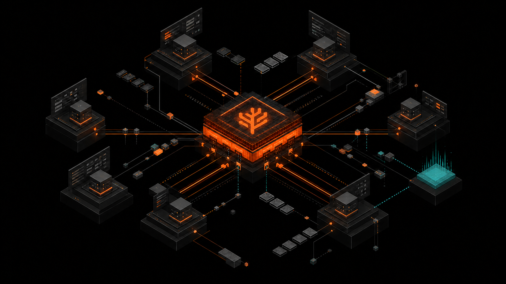

<div align="center">
  

  <h1>Coral Agent Skills</h1>

  <p>
    One installable Coral Protocol skill for building agents and applications
    on Coral Server or Coral Cloud.
  </p>

  <p>
    <a href="https://github.com/Coral-Protocol/coral-server">Coral Server</a>
    ·
    <a href="https://docs.coralos.ai">Docs</a>
  </p>

  <p>
    <strong><a href="https://coralcloud.ai">Sign up for Coral Cloud</a></strong>
    and receive $30 in LLM proxy credits for your agents' model calls.
  </p>

</div>

`coral-skills` gives Codex, Claude Code and other coding agents a single
entrypoint for building on Coral. It covers writing agents from the Koog
template, integrating an application with Coral Server's HTTP API through
session requests and signed custom-tool callbacks, configuring and deploying the
server, and debugging sessions during development. It routes each request to the
smallest relevant reference, ships a mirror of the official Coral docs, and uses
the target server's machine-readable schema as the source of truth.

## Build An Agent System

Point Codex at an application repository and ask for the outcome directly:

```text
$coral-skills Add a Coral agent system to this application. Users ask a
question, specialist agents collaborate in a session, and the app stores one
approved structured answer that the agents submit through a custom tool.
Implement the first working slice and test it end to end.
```

The skill guides Codex to:

- distinguish role prompts from genuinely separate agent implementations;
- build new agents from the Koog template, and ship agent definitions with the server deployment;
- have the application create sessions over HTTP and pass the task in through agent options and system prompts;
- return results through least-privilege custom tools with verified signatures;
- preserve application ownership of users, permissions, artifacts, and durable state;
- build payloads from the live Coral schema instead of remembered request shapes;
- verify the slice with a real test session, then close it.

## Install For Claude Code

```text
/plugin marketplace add Coral-Protocol/coral-skill-set
```

```text
/plugin install coral-skills@coral-skill-set
```

```text
/reload-plugins
```

## Install For Codex

```bash
codex plugin marketplace add Coral-Protocol/coral-skill-set
codex plugin add coral-skills@coral-skill-set
```

Confirm installation:

```bash
codex plugin list --marketplace coral-skill-set
```

## Skill

| Invocation | Description |
|---|---|
| `/coral-skills` in Claude Code, `$coral-skills` in Codex | Build Coral agents and applications, or route a focused Coral task to the minimal agent, integration, deployment, Cloud, custom-tool, or topology guidance. |

## Reference Routing

The public skill is a strict router. It loads one primary reference by default
and adds a second only when the request crosses boundaries, such as Cloud plus
custom tools or app integration plus session debugging. Concept and reference
questions go to the docs mirror in `docs/`.

| Reference | Used for |
|---|---|
| [`build-application-agent-system.md`](plugins/coral-skills/skills/coral-skills/references/build-application-agent-system.md) | Turning an application requirement into agents, graph topology, application backend code, custom-tool callbacks, and a tested working slice. |
| [`coral-setup.md`](plugins/coral-skills/skills/coral-skills/references/coral-setup.md) | Running, configuring, deploying, or troubleshooting Coral Server, including how a deployment gets its agents. |
| [`coral-runtime-reference.md`](plugins/coral-skills/skills/coral-skills/references/coral-runtime-reference.md) | Finding the current machine-readable Coral API, OpenAPI schema, endpoint shapes, manifests, and source fallback. |
| [`coralize-your-agent.md`](plugins/coral-skills/skills/coral-skills/references/coralize-your-agent.md) | Writing or porting agents with the Koog template as reference, wrapping MCP servers, `coral-agent.toml`, and agent discovery during development. |
| [`coral-session-debugging.md`](plugins/coral-skills/skills/coral-skills/references/coral-session-debugging.md) | Inspecting and testing sessions during development: agent status, budgets, test messages, and cleanup. |
| [`coral-app-integration.md`](plugins/coral-skills/skills/coral-skills/references/coral-app-integration.md) | Wiring Coral into an application while keeping runtime/session coordination separate from durable app state. |
| [`cloud-runtime.md`](plugins/coral-skills/skills/coral-skills/references/cloud-runtime.md) | Coral Cloud API keys, marketplace agents, Cloud Console payloads, LLM proxy, billing, and hosted-runtime boundaries. |
| [`custom-tools.md`](plugins/coral-skills/skills/coral-skills/references/custom-tools.md) | App callbacks, `customTools`, `customToolAccess`, `APP_BASE_URL`, application IDs, secrets, and signature verification. |
| [`setup-patterns.md`](plugins/coral-skills/skills/coral-skills/references/setup-patterns.md) | Session ownership, application backends, self-hosted deployments, and orchestration patterns. |
| [`coral-coordination-topologies.md`](plugins/coral-skills/skills/coral-skills/references/coral-coordination-topologies.md) | Choosing or reviewing multi-agent communication structures in Coral terms. |
| [`topologies.md`](plugins/coral-skills/skills/coral-skills/references/topologies.md) | Supporting vocabulary for common and niche multi-agent coordination topologies. |

## Getting Started

1. Install the plugin for Claude Code or Codex.
2. Invoke `/coral-skills` in Claude Code or `$coral-skills` in Codex.
3. Ask for the product outcome directly: build an application agent system,
   write or port an agent, deploy a server, inspect a schema, wire a Cloud
   custom-tool callback, debug a session, or reason about a coordination topology.
4. When exact API calls matter, the skill should fetch the current
   `BASE_URL/api_v1.json` or use the most relevant source fallback.

For Cloud Console exports or marketplace agents, the skill routes agents to the
Cloud runtime and custom-tool callback checklists without copying the full Cloud
API schema into the skillset.

## Prerequisites

- Claude Code or Codex.
- JDK 24 and Git to run Coral Server from source, or Docker for the published image.
- Node.js/npm only for `npm create koog` and Coralizer's `link` command.
- Coral Cloud credentials only when the user is working with Cloud-specific
  sessions, marketplace agents, billing, LLM proxy, or custom-tool callbacks.

## Maintaining The Docs Mirror

The skill's `docs/` directory is generated from a checkout of
[Coral-Protocol/Docs](https://github.com/Coral-Protocol/Docs). Do not edit it by
hand. Regenerate it after the docs change, or check whether it is stale:

```bash
scripts/sync_docs.py --docs-repo ../Docs
scripts/sync_docs.py --docs-repo ../Docs --check
```

## License

MIT
