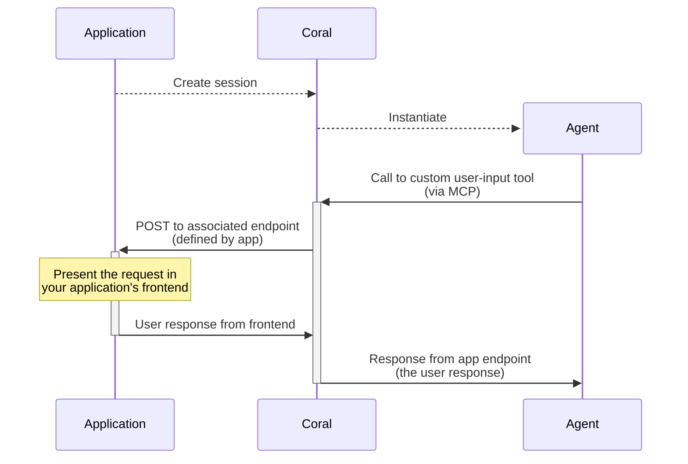

# Integrating with your application

Using Coral Server from, and integrating it with your application

Source: https://docs.coralos.ai/guides/integrating-with-your-app

> **Note:**
>
> See also [this guide](../guides/production/running-in-production.md) on deploying Coral Server in production

Use the [HTTP API](../api-reference/endpoints.md#create-session) from your application to create sessions and handle results. Coral Console supports development and debugging. The public server also exposes Kotlin APIs for embedding; the HTTP integration described here works independently of your application's language.

> **Tip:**
>
> Coral Server also serves a dedicated API reference at `/ui/docs`. The OpenAPI schema is also available at `/api_v1.json`.

## Creating Sessions

The create session endpoint is one of the most important endpoints - it's how you define and instantiate graphs of agents.

While [Coral Console](../concepts/coral-console.md) has a ready-made interface over this endpoint, when integrating Coral with your application - you'll want to use this API directly.

> **Tip:**
>
> You can use the JSON available in [Coral Console's](../concepts/coral-console.md) editor pane when editing a session template - to quickly get a usable request body for your own POST to [`/api/v1/local/session`](../api-reference/endpoints.md#create-session).

Every application API call needs one of the server's [auth keys](../reference/server/auth.md) in an `Authorization: Bearer` header. Agent secrets do not authenticate these endpoints.

### Minimal request body

The body is a [`SessionRequest`](../api-reference/schemas.md#sessionrequest). It needs an `agentGraphRequest` with at least one agent, and a `namespaceProvider`.

```json
{
  "agentGraphRequest": {
    "agents": [
      {
        "id": {
          "name": "example-agent",
          "version": "0.1.0",
          "registrySourceId": { "type": "local" }
        },
        "name": "example",
        "provider": {
          "type": "local",
          "runtime": "docker"
        },
        "systemPrompt": "You are a helpful agent."
      }
    ]
  },
  "namespaceProvider": {
    "type": "create_if_not_exists",
    "namespaceRequest": {
      "name": "demo",
      "deleteOnLastSessionExit": true
    }
  },
  "execution": {
    "mode": "immediate",
    "runtimeSettings": { "ttl": 300000 }
  }
}
```

```bash
curl -X POST http://localhost:5555/api/v1/local/session \
  -H 'Content-Type: application/json' \
  -H "Authorization: Bearer $CORAL_TOKEN" \
  -d @session.json
```

The response contains the session's `namespace` and `sessionId`. [Sessions](../concepts/sessions.md#session-lifecycle) describes what happens from creation to termination.

## Custom Tools

There are a lot of scenarios where agents need to be given capabilities that are tightly integrated with your application. While you can hard code these kinds of tools in agents you write yourself, when using agents from other developers - this doesn't work.

For this reason, Coral Server supports passing custom MCP tools to agents at runtime.

When an agent calls one of these custom tools, Coral Server sends a request to an endpoint you provide, to know how to respond.

### Example - User Input

A common use case in applications is exposing some kind of "chat"-style agent to your end users. This can be implemented using custom tools.

One tool can request user input: Coral calls your application endpoint, and the endpoint's response supplies the user's answer to the waiting agent. A separate output tool can submit results or display progress. Long-lived user interactions need application storage and timeout handling.

As an example, the flow for a user‑input custom tool looks (roughly) like:



### Callback contract

For an HTTP custom tool, Coral POSTs the tool argument object to your configured URL with `/{sessionId}/{agentName}` appended. It supplies `X-Coral-Namespace`, `X-Coral-SessionId`, and `X-Coral-AgentName` headers. Verify the `X-Coral-Signature` header against a lowercase hexadecimal HMAC-SHA256 over the exact request body bytes, using `network.customToolSecret`. The transport can override the signature header name.

Return **HTTP 200** with the tool result. The public server wraps the response body in MCP text content. Other HTTP statuses become tool errors. Custom tool callbacks and end-report webhooks are separate contracts: end reports use `network.webhookSecret` and the exact configured URL.

Signatures cover the body, not the URL or identity headers. Use a job-specific callback URL, check the expected session and agent against application-owned state, and make result handling idempotent. Store results before returning success. The public server does not provide a durable callback queue or a delivery guarantee.

### Complete application example

`application.mjs` below is a runnable Node.js integration. It starts a callback server, verifies signatures before parsing JSON, creates a deferred session, saves the session-to-user mapping, and then starts execution. A distinct callback URL identifies each job. The example uses an in-memory map; replace it with shared durable storage for a deployed application.

#### application.mjs

```javascript application.mjs
import { createServer } from 'node:http';
import { createHmac, randomUUID, timingSafeEqual } from 'node:crypto';

export function verifySignature(bytes, signature, secret) {
  if (typeof signature !== 'string' || !/^[a-f0-9]{64}$/i.test(signature)) return false;
  return timingSafeEqual(Buffer.from(signature, 'hex'), createHmac('sha256', secret).update(bytes).digest());
}

// This runnable example uses memory for jobs. Use shared durable storage in a deployed application.
export async function createReportApplication({ coralUrl, token, callbackSecret, callbackBaseUrl, port = 0 }) {
  if (!token || !callbackSecret) throw new Error('Server auth token and custom tool secret are required');
  const jobs = new Map();
  const server = createServer(async (req, res) => {
    const respond = (status, body) => {
      res.writeHead(status, { 'Content-Type': 'application/json' });
      res.end(JSON.stringify(body));
    };
    try {
      const parts = new URL(req.url, 'http://localhost').pathname.split('/').filter(Boolean);
      if (req.method !== 'POST' || parts.length !== 4 || parts[0] !== 'reports') return respond(404, { error: 'Unknown callback' });
      const [, jobKey, sessionId, agentName] = parts.map(decodeURIComponent);
      const job = jobs.get(jobKey);
      if (!job || job.session?.sessionId !== sessionId || job.agentName !== agentName) return respond(404, { error: 'Unknown job' });
      const chunks = []; let length = 0;
      for await (const chunk of req) {
        length += chunk.length;
        if (length > 1024 * 1024) return respond(413, { error: 'Report too large' });
        chunks.push(chunk);
      }
      const raw = Buffer.concat(chunks);
      if (!verifySignature(raw, req.headers['x-coral-signature'], callbackSecret)) return respond(401, { error: 'Invalid signature' });
      const report = JSON.parse(raw.toString('utf8'));
      if (typeof report.title !== 'string' || typeof report.content !== 'string') return respond(400, { error: 'Invalid report' });
      if (!job.report) {
        // Persist the result under the trusted application's user/job mapping, never a user ID from the callback.
        job.report = { ...report, userId: job.userId };
        job.resolve(job.report);
      }
      respond(200, { success: true, reportId: jobKey });
    } catch {
      respond(400, { error: 'Invalid callback' });
    }
  });
  await new Promise((resolve, reject) => { server.once('error', reject); server.listen(port, '127.0.0.1', resolve); });
  const localUrl = `http://127.0.0.1:${server.address().port}`;
  const callbacks = (callbackBaseUrl ?? localUrl).replace(/\/$/, '');
  async function api(path, body, method = 'POST') {
    const response = await fetch(coralUrl.replace(/\/$/, '') + path, {
      method, headers: { Authorization: `Bearer ${token}`, 'Content-Type': 'application/json' },
      ...(body === undefined ? {} : { body: JSON.stringify(body) }),
    });
    if (!response.ok) throw new Error(`Coral ${method} ${path}: ${response.status} ${await response.text()}`);
    const text = await response.text();
    return text ? JSON.parse(text) : undefined;
  }
  return {
    localUrl,
    // Call only after authenticating the application user. `agent` is a full GraphAgentRequest.
    async startReport(userId, agent) {
      const jobKey = randomUUID();
      let resolveResult;
      const result = new Promise(resolve => { resolveResult = resolve; });
      const job = { userId, agentName: agent.name, resolve: resolveResult };
      jobs.set(jobKey, job);
      let path;
      try {
        job.session = await api('/api/v1/local/session', {
          namespaceProvider: { type: 'create_if_not_exists', namespaceRequest: { name: 'reports', deleteOnLastSessionExit: true } },
          execution: { mode: 'defer' },
          agentGraphRequest: {
            agents: [{ ...agent, customToolAccess: [...new Set([...(agent.customToolAccess ?? []), 'submit_report'])] }],
            customTools: { submit_report: {
              description: 'Submit the finished report to the application',
              inputSchema: { type: 'object', properties: { title: { type: 'string' }, content: { type: 'string' } }, required: ['title', 'content'] },
              outputSchema: { type: 'object', properties: { success: { type: 'boolean' }, reportId: { type: 'string' } } },
              transport: { type: 'http', url: `${callbacks}/reports/${jobKey}` },
            } },
          },
        });
        // The mapping exists before execution starts, including callbacks made immediately at startup.
        path = `/api/v1/local/session/${encodeURIComponent(job.session.namespace)}/${encodeURIComponent(job.session.sessionId)}`;
        await api(path, { ttl: 300000, persistenceMode: { mode: 'hold_after_exit', duration: 60000 } });
        return {
          session: job.session, result,
          async close() { try { await api(path, undefined, 'DELETE'); } finally { jobs.delete(jobKey); } },
        };
      } catch (error) {
        jobs.delete(jobKey);
        if (path) await api(path, undefined, 'DELETE').catch(() => {});
        throw error;
      }
    },
    async close() {
      server.closeAllConnections();
      await new Promise(resolve => server.close(resolve));
    },
  };
}
```

After copying that file, use it from your application's trusted backend:

```javascript
import { createReportApplication } from './application.mjs';

const app = await createReportApplication({
  coralUrl: process.env.CORAL_SERVER_URL,
  token: process.env.CORAL_AUTH_TOKEN,
  callbackSecret: process.env.CORAL_CUSTOM_TOOL_SECRET,
  // For a remote server, use an HTTPS URL that forwards to this example's local listener.
  callbackBaseUrl: process.env.CALLBACK_BASE_URL,
  port: 8080
});

const job = await app.startReport('authenticated-user-id', {
  id: { name: 'report-writer', version: '1.0.0', registrySourceId: { type: 'local' } },
  name: 'writer',
  provider: { type: 'local', runtime: 'prototype' },
  options: { TASK: { type: 'string', value: 'Write a short report and call submit_report.' } }
});

let timer;
try {
  const timeout = new Promise((_, reject) => {
    timer = setTimeout(() => reject(new Error('Report timed out')), 300000);
  });
  const report = await Promise.race([job.result, timeout]);
  console.log(report);
} finally {
  clearTimeout(timer);
  await job.close();
  await app.close();
}
```

The sample uses a simple prototype to make the callback flow easy to reproduce. For production agents with custom context management or control flow, the [Koog template](../guides/quickstart.md#koog-template) is the main authoring path; the application API and callback contract stay the same.

This example uses the complete [prototype agent definition](../reference/agent/tables/runtimes/prototype.md#complete-agent-definition). For Coral Cloud, discover an available agent and use the callback verification credentials supported by that deployment; do not assume your Cloud API key is a webhook signing secret.
